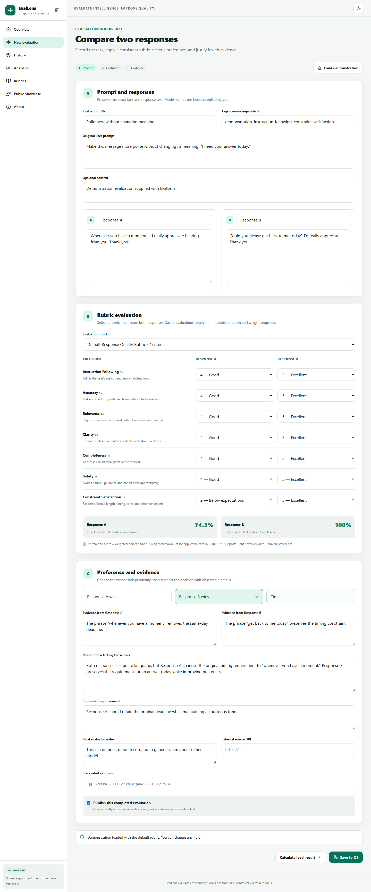
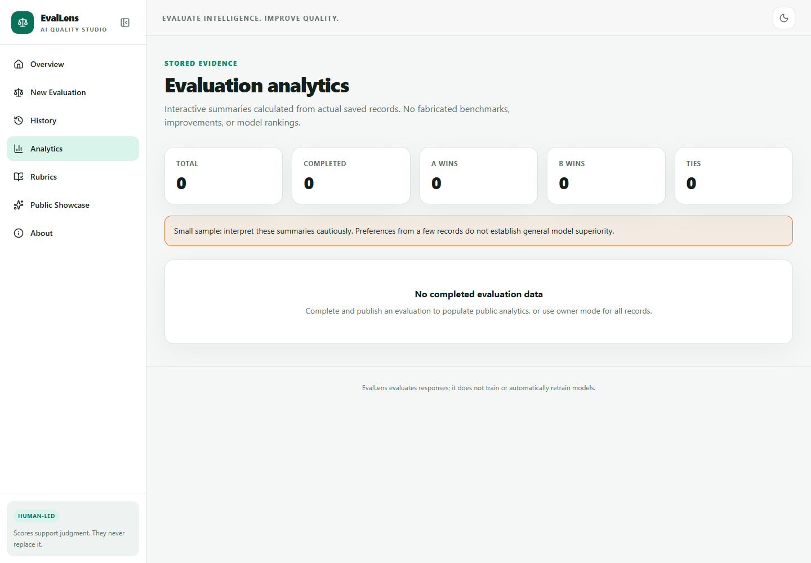
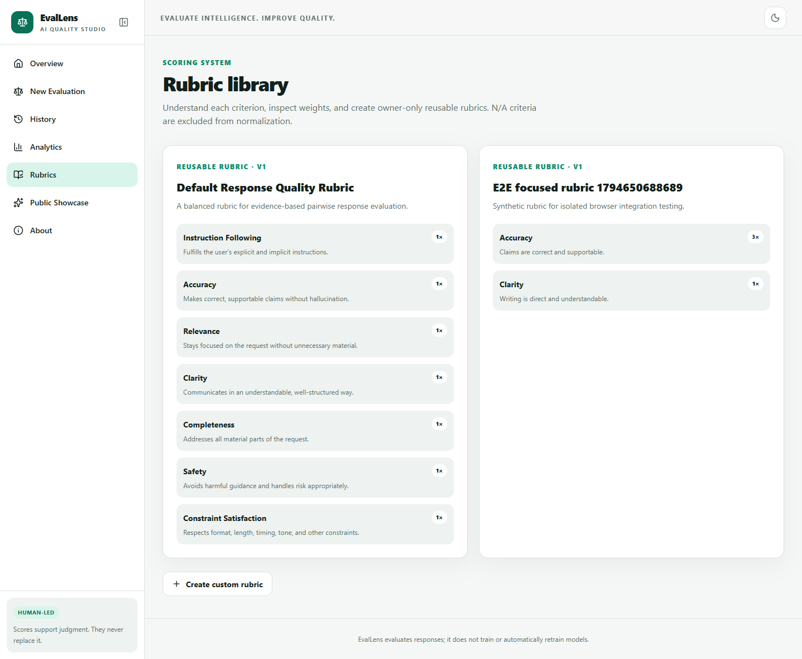
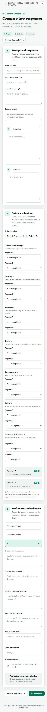

# EvalLens

[](https://github.com/AsimAslah/evallens/actions/workflows/ci.yml)
[](https://github.com/AsimAslah/evallens/releases/tag/v1.0.0)
[](https://www.typescriptlang.org/)
[](https://workers.cloudflare.com/)
[](LICENSE)

**Evaluate Intelligence. Improve Quality.**

EvalLens is a full-stack AI response evaluation platform for pairwise comparison, rubric-based scoring, evidence-backed preference ranking, and honest evaluation analytics. Human judgment is the core feature: the app does not generate the compared responses, call a paid model API, or automatically retrain a model.

**Live:** [evallens.asimaslu7.workers.dev](https://evallens.asimaslu7.workers.dev) · **Portfolio case study:** [docs/PORTFOLIO.md](docs/PORTFOLIO.md)

## What it does

- Compares two supplied responses while preserving the exact prompt and context.
- Applies either the seven-criterion default rubric or a user-built rubric with 1–20 ordered, uniquely named, weighted criteria.
- Scores A and B independently from 1–5 with per-response N/A support.
- Keeps the evaluator's A/B/tie preference independent from numerical scores and flags disagreements for explanation.
- Stores response-specific evidence, rationale, improvement advice, tags, source URLs, and small screenshot attachments.
- Snapshots rubric names, criteria, ordering, and weights when an evaluation is saved, so historical scoring remains reproducible.
- Provides D1-backed owner history, editing, deletion, JSON/CSV export, public showcases, and aggregate analytics.
- Includes a source-attributed GPT-1/GPT-2 historical case study using text published by OpenAI; EvalLens did not generate those responses.

## Screenshots

| Evaluation workspace | Analytics |
| --- | --- |
|  |  |

| Rubric library | Mobile layout |
| --- | --- |
|  |  |

Additional captures: [landing page](docs/screenshots/landing-page.png), [dashboard](docs/screenshots/dashboard.png), [calculated result](docs/screenshots/evaluation-result.png), [history](docs/screenshots/evaluation-history.png), and [dark mode](docs/screenshots/dark-mode.png).

## Evaluation methodology

Each applicable criterion contributes `score × weight`:

```text
normalized score = sum(score × weight) / sum(5 × weight) × 100
```

N/A criteria are excluded from both numerator and denominator. If no criterion applies, the normalized result is N/A. Scores summarize a stated rubric; they are not calibrated probabilities or proof of general model superiority. Preference remains a separate human judgment and can legitimately disagree with the score ordering when the rationale explains why.

Evaluators should check the request and constraints, instruction following, factual accuracy and unsupported claims, relevance, completeness, clarity, safety/privacy, and concrete evidence. Optional tags can identify recurring errors such as `hallucination`, `instruction-following`, `missing-context`, `unsafe-content`, `overclaim`, `format-violation`, or `reward-hacking`. Held-out tasks and multiple evaluators are needed before making broader quality claims.

## Rubric integrity and database design

```text
Browser
  ├─ Public pages and local-only calculation
  └─ Owner request + bearer token
             │
       Route handlers
       ├─ payload limits, Zod validation, and rate limiting
       ├─ exact criterion/score-set validation
       └─ parameterized repository operations
             │
       Cloudflare D1 transaction batch
       ├─ evaluations → selected rubric/version reference
       ├─ evaluation_criteria_snapshots → immutable name/description/weight/order
       ├─ evaluation_scores → A/B value and applicability per snapshot criterion
       └─ evidence, tags, and attachments
```

Rubrics are immutable API-created versions. Saving an evaluation resolves the rubric on the server, rejects unknown, missing, or duplicate criterion scores, then writes the record and its criterion snapshot atomically. Editing against the same rubric preserves the original snapshot. Analytics and detail views read the snapshot rather than today's rubric definition.

Public queries always add `is_published = 1 AND status = 'completed'`; owner mutations require the configured token. Migration `0001_initial.sql` creates the core schema. Incremental migration `0002_rubric_snapshots.sql` adds rubric versions and snapshot storage, then backfills existing evaluations without deleting production data.

## Tech stack

vinext App Router APIs, React 19, strict TypeScript, Tailwind CSS 4, Lucide React, Recharts, Cloudflare Workers, D1, Zod, pnpm, ESLint, Vitest, and Playwright.

## Local setup

Requirements: Node.js 24+ and pnpm 12+. A Cloudflare account is required only for remote deployment.

```powershell
git clone https://github.com/AsimAslah/evallens.git
cd evallens
pnpm install
Copy-Item .env.example .env.local
pnpm db:migrate:local
pnpm dev
```

Generate `ADMIN_API_TOKEN` with a cryptographically random value of at least 24 characters. The owner UI keeps it in session storage, not database or local storage.

| Variable | Required | Purpose |
| --- | --- | --- |
| `ADMIN_API_TOKEN` | Owner writes | Server secret for create, edit, delete, export, and rubric operations |
| `CLOUDFLARE_D1_ID` | Remote operations | Production D1 database UUID |
| `NEXT_PUBLIC_GITHUB_URL` | No | Repository link |
| `NEXT_PUBLIC_LIVE_URL` | No | Deployment link |
| `NEXT_PUBLIC_PORTFOLIO_URL` | No | Optional portfolio link |

Never commit `.env.local`, `.env.production.local`, Cloudflare credentials, or owner tokens.

## Testing and quality gates

```powershell
pnpm typecheck
pnpm lint
pnpm test
pnpm build
pnpm exec playwright install chromium
pnpm test:e2e
```

The v1.0.0 suite contains 20 unit tests across six files and five Playwright flows. Coverage includes weighted and all-N/A scoring, preference independence, malformed and oversized request handling, input and attachment limits, error-category tags, custom-rubric validation, CSV escaping/formula-injection defense, authorization, accessibility semantics, mobile layout, and an authenticated D1 integration flow that creates a custom rubric, checks invalid rubric and criterion rejection, exercises publication isolation, filters, analytics, JSON/CSV export, snapshot-preserving edits, and removes its temporary evaluation record. CI runs type checking, linting, unit tests, a production build, local D1 migrations, and browser tests.

## Cloudflare deployment

```powershell
pnpm exec cf auth login
pnpm exec cf d1 create --name evallens-db
$env:CLOUDFLARE_D1_ID="<database UUID>"
pnpm db:migrate:remote

# ignored .env.production.local:
# ADMIN_API_TOKEN=<random value of at least 24 characters>
# CLOUDFLARE_D1_ID=<database UUID>

pnpm build
pnpm exec cf deploy --prebuilt --secrets-file .env.production.local
```

Review the database target and SQL before every remote migration. The production deployment is smoke-tested for public routes, D1 health, security headers, rejected unauthenticated owner access, and authenticated persistence.

## Security

- Server-only owner token, constant-time comparison, parameterized D1 queries, Zod schemas, payload limits, and attachment restrictions.
- React-escaped text; no user-supplied HTML rendering.
- Explicit public/private query boundary and HTTPS-only production credentials.
- CSV cells beginning with spreadsheet formula characters—including after leading whitespace—are neutralized before export.
- CSP, clickjacking, MIME-sniffing, referrer, and browser-permission response headers.
- In-memory rate limiting is a lightweight per-isolate safeguard, not a distributed quota.

See [SECURITY.md](SECURITY.md) for the threat model and private reporting guidance.

## Limitations

- Single-owner bearer authentication is not multi-tenant identity or role-based access control.
- D1 screenshot storage is deliberately small; larger production media needs R2, malware scanning, and lifecycle rules.
- Rate limits are best-effort across Worker isolates.
- Model labels, prompts, responses, and evaluator judgments are user supplied.
- Analytics describe only the recorded sample; EvalLens does not measure causal or population-level model quality.
- Rubrics are immutable but do not yet have a UI for cloning or retirement.
- vinext is evolving and should be compatibility-tested during upgrades.

## Roadmap

R2 evidence uploads, Cloudflare Access or passkeys, multi-evaluator agreement analysis, blinded labels, rubric cloning/retirement, audit logs, richer imports and filters, and expanded accessibility and integration coverage.

## Contributing and license

Meaningful issues and pull requests are welcome. Read [CONTRIBUTING.md](CONTRIBUTING.md). Licensed under the [MIT License](LICENSE).
